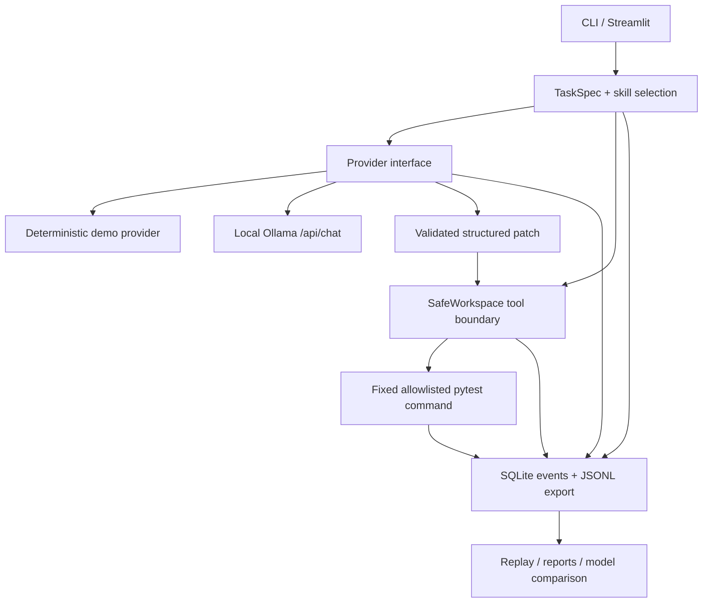

# ForgeBench — Open-Source AI Agent Reliability Lab

ForgeBench is a local-first evaluation harness for coding agents using open-weight models. It integrates four workflows behind one task schema, execution runtime, trace store, and objective test runner:

- **SkillBench** validates Agent Skills metadata and records whether a required skill was selected.
- **TraceForge** persists structured run events, exports/imports JSONL, and replays recorded tool I/O without rerunning a model.
- **RepoPilot** proposes source patches against disposable fixture copies, blocks writes to tests and out-of-workspace paths, and runs only a fixed allowlisted test command after approval.
- **SmallModel Lab** repeats identical tasks with clean starting fixtures and compares measured outcomes across configured model tags.

The integrated loop is: **task → skill → model → constrained patch → independent tests → trace → comparison → regression rerun**.

> **Current MVP boundary:** the shipped benchmark suite and safe workspace runner are implemented and tested. The model currently returns a structured patch rather than participating in a long-running, model-directed tool-call conversation. Arbitrary external repositories are not yet accepted by the CLI benchmark command. Path restrictions and command allowlists are application safeguards, not an OS-level sandbox; do not run untrusted repository tests without inspecting them or isolating execution more strongly.

## Architecture



The shared data contracts live in `src/forgebench/schemas.py`. Model outputs are parsed with Pydantic before application. The evaluator does not use a model-generated self-rating: `pytest` exit status and the explicit required-skill criterion determine objective task success.

## Prerequisites

- Python **3.11+**.
- Windows PowerShell, Linux, or macOS.
- For real inference: [Ollama](https://ollama.com/download), plus a model downloaded locally.
- For the browser dashboard: Streamlit, installed through the `dashboard` extra.

No paid AI API is used. The model is not bundled with the repository.

## Installation

### Windows PowerShell

```powershell
cd ForgeBench
py -3.11 -m venv .venv
.\.venv\Scripts\Activate.ps1
python -m pip install --upgrade pip
python -m pip install -e ".[dev,dashboard]"
Copy-Item .env.example .env
```

If PowerShell blocks environment activation, open a terminal that is permitted by your local system policy or invoke the environment's Python directly as `\.venv\Scripts\python.exe`.

### Linux / macOS

```bash
cd ForgeBench
python3 -m venv .venv
source .venv/bin/activate
python -m pip install --upgrade pip
python -m pip install -e '.[dev,dashboard]'
cp .env.example .env
```

`.env` is optional and should remain local. ForgeBench reads local settings via `python-dotenv`; `.env` is excluded by `.gitignore`. Never put credentials or private data in example configuration.

## First smoke test (no model download)

The deterministic provider exists for offline tests and demos. Its results are clearly marked `mock`; these are **not evidence of real-model capability**.

```powershell
python -m forgebench.cli list-tasks
python -m forgebench.cli skills --skills-root examples/skills
python -m forgebench.cli validate-skill examples/skills/python-bugfix
python -m forgebench.cli benchmark --tasks all --provider mock --approve-tests
python -m forgebench.cli history
python -m pytest -q
```

`--approve-tests` explicitly authorizes the fixed command `python -m pytest -q` to run inside disposable copies of the shipped, self-contained fixtures. Without approval, ForgeBench can record the proposed patch, but it does not mark the task verified.

Reports are written to `reports/benchmark-report.json` and `reports/benchmark-report.md`; local database and workspaces default to `forgebench.sqlite3` and `runs/`. These generated files are ignored by Git.

## Run the dashboard

```powershell
streamlit run app.py
```

Open the local URL printed by Streamlit. Views include overview/readiness, skill validation, benchmark runner, persisted trace inspection/replay, model comparison, and configuration. Empty states are intentional: charts and statistics are based on recorded runs only.

When capturing screenshots for a release, capture (1) the readiness overview with the actual provider status, (2) valid/invalid SkillBench diagnostics, (3) a benchmark's real output, (4) a trace showing a rejected tool call and recorded replay, and (5) model comparison with the trial count visible. Do not use mock results as a claim about model quality.

## Connect an actual local open-weight model

1. Install Ollama for your operating system using the [official installation page](https://ollama.com/download). On Windows, the Ollama server exposes its local API at `http://localhost:11434` by default ([official Windows documentation](https://github.com/ollama/ollama/blob/main/docs/windows.mdx)).
2. Pull a model suitable for your hardware, for example:

   ```powershell
   ollama pull qwen2.5-coder:7b
   ```

3. Set the ForgeBench provider and tag in `.env`:

   ```dotenv
   FORGEBENCH_PROVIDER=ollama
   FORGEBENCH_OLLAMA_URL=http://localhost:11434
   FORGEBENCH_OLLAMA_MODEL=qwen2.5-coder:7b
   ```

4. Check readiness, then run a real task:

   ```powershell
   python -m forgebench.cli ollama-health --model qwen2.5-coder:7b
   python -m forgebench.cli run --task fix-zero-classification --provider ollama --model qwen2.5-coder:7b --approve-tests
   ```

ForgeBench calls Ollama's documented, non-streaming `POST /api/chat` endpoint and validates the returned JSON before any patch is applied ([Ollama API reference](https://github.com/ollama/ollama/blob/main/docs/api.md)). If the server or model is unavailable, a diagnostic is shown. No real-model benchmark was run as part of this project build because it depends on a local Ollama installation and a pulled model.

### Model licence note

The [upstream Qwen2.5-Coder-7B-Instruct model card](https://huggingface.co/Qwen/Qwen2.5-Coder-7B-Instruct) lists Apache-2.0. This is upstream model information; check the exact Ollama package/tag, model card, and licence files before redistributing model weights. ForgeBench's MIT licence covers this project's original code, not third-party model weights or dependencies.

## Skills

Canonical skill format reference: [Agent Skills specification](https://agentskills.io/specification). A directory contains `SKILL.md` with YAML frontmatter and Markdown instructions. ForgeBench validates required fields (`name`, `description`), allowed optional fields, name/directory agreement, field lengths/types, and bundled files. Unknown frontmatter keys are reported as forward-compatibility warnings, separately from conformance errors. Standard validation is distinct from scenario outcomes and run success.

```powershell
python -m forgebench.cli validate-skill examples/skills/python-bugfix
python -m forgebench.cli skills --skills-root examples/skills
```

The sample library includes two skills. The selected skill's text is treated as untrusted reference input in the model prompt, not as permission to bypass tool policy.

## Tasks, benchmarks, reports, and trace replay

List the current reproducible tasks in `benchmarks/tasks.json`. Each task has a stable ID, description, fixture path, required skill, timeout, target test, suite version, and tags. The fixtures seed a small bug and assert boundary behaviour. A fresh disposable workspace is copied for each repetition/model.

```powershell
# One task, mock demo
python -m forgebench.cli run --task fix-zero-classification --provider mock --approve-tests

# All tasks, repeated trials
python -m forgebench.cli benchmark --tasks all --provider mock --repetitions 3 --approve-tests

# Compare two local model tags (both must already be installed)
python -m forgebench.cli benchmark --tasks all --provider ollama --models qwen2.5-coder:7b qwen2.5-coder:3b --repetitions 2 --approve-tests

# Inspect and export one run
python -m forgebench.cli history
python -m forgebench.cli events RUN_ID
python -m forgebench.cli export-trace RUN_ID --output reports/RUN_ID.jsonl
python -m forgebench.cli replay --input reports/RUN_ID.jsonl
python -m forgebench.cli compare
```

Recorded replay reproduces stored tool outputs for inspection. It does not rerun the LLM, rerun commands, or imply that a nondeterministic model's internal reasoning can be reproduced. JSONL imports are size-bounded, schema-validated, and report incomplete traces. Local traces can be deleted using `delete-run RUN_ID --confirm`.

Reported measurements include verified task success rate, test pass rate, valid structured-output rate, required-skill selection rate, median latency, observed token counts when the provider returns them, tool-policy rejection rate, failure categories, and a descriptive repeat-run agreement measure where multiple verified trials exist. Missing token/resource metrics remain unavailable. There is no statistical-significance claim.

## Inspect a recorded failure (offline)

A labelled trace fixture is included at `examples/traces/failed-policy-rejection.jsonl`. It is an illustrative fixture, not a benchmark measurement. It records a path-traversal tool rejection so you can inspect and replay the recorded output without invoking a model or command:

```powershell
python -m forgebench.cli replay --input examples/traces/failed-policy-rejection.jsonl
```

## Tests and quality checks

```powershell
python -m compileall -q src app.py tests
python -m pytest -q
```

The test suite covers Pydantic schemas, skill validation, workspace traversal/protected-write rules, approval-gated verification, SQLite run/event storage, JSONL export/import, replay and malformed/incomplete traces, and all three end-to-end mock fixtures. Provider API tests mock HTTP responses; the live Ollama path still requires the user's local model to be installed.

## Security and privacy model

- Model output is parsed and validated before use; model content never becomes a shell command.
- The model can patch only existing non-test Python files in the disposable workspace. Tests and credentials/config files are protected.
- Relative paths, absolute paths, Windows drive paths, parent traversal, and symlinks are rejected.
- Verification is fixed to a non-shell argument vector (`sys.executable -m pytest -q`), timeout-bounded, output-capped, and requires explicit approval.
- Trace metadata is size-bounded and redacts common credential patterns before persistence; inspect files before sending private code to any model provider.
- The app does not promise full container/OS isolation. Test code executes as the current user within a disposable copy. Do not point it at untrusted external repositories until stronger isolation is configured.
- No repository secrets, model weights, or user credentials are shipped in this project.

See [threat model](docs/threat-model.md) and [benchmark methodology](docs/benchmark-methodology.md).

## Project structure

```text
forgebench/
├── app.py
├── pyproject.toml
├── .env.example
├── src/forgebench/
│   ├── cli.py, config.py, schemas.py
│   ├── providers/       # Ollama + deterministic mock
│   ├── skills/          # frontmatter validator + selection
│   ├── agent/           # shared execution runtime
│   ├── repository/      # workspace policy, patching, tests
│   ├── tracing/         # SQLite, JSONL, recorded replay
│   ├── benchmarks/      # tasks + fresh-fixture runner
│   └── reporting/       # JSON/Markdown reports and comparison
├── examples/skills/     # two sample Agent Skills
├── examples/fixtures/   # isolated benchmark starting states
├── examples/sample_repo/# larger intentionally buggy sample repository
├── benchmarks/tasks.json
├── tests/{unit,integration,security}/
└── docs/{architecture,threat-model,benchmark-methodology}.md
```

## Known limitations and next improvements

1. Add an iterative model-directed tool-call loop with explicit schemas for list/read/search/diff/patch/test, while continuing to deny unrestricted shell access.
2. Add optional container-backed isolation and a documented, user-controlled integration for arbitrary local repositories.
3. Add behavioral skill scenarios with richer deterministic assertions and suite version pinning.
4. Add more language/framework fixtures, patch quality metrics, memory/resource telemetry, and versioned benchmark baselines.
5. Add cancellation, retention policy configuration, and a broader redaction audit.

No public repository, release, screenshot, contributor list, benchmark leaderboard, or adoption claim is implied by this local project artifact.
