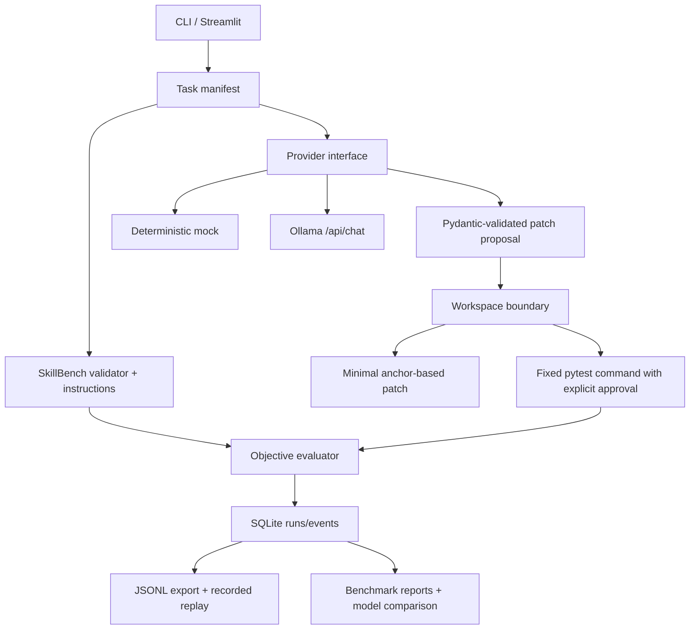

# Architecture

ForgeBench uses a shared task schema, provider contract, trace event contract, and result model.

## Run lifecycle

1. Load a versioned task record and validate its skill.
2. Copy a bundled starting fixture into a new disposable directory.
3. Send task description, skill instructions, and only the configured target source to the selected provider.
4. Validate the returned structure with Pydantic.
5. Apply a minimal exact-anchor patch only when path and source-policy checks pass.
6. Run a fixed `python -m pytest -q` argument vector only with explicit approval.
7. Mark the task verified only when tests return zero **and** the required skill name was selected.
8. Persist the run and bounded, redacted events; reports derive from those records.

## Adapter and limitations

Ollama is called using its documented `/api/chat` endpoint with `stream: false` and a JSON schema in `format`. The first MVP asks for one structured patch instead of exposing a free-form iterative tool-call loop. Mock output is deterministic and labelled. The model's token counts are recorded only where reported by the API.
